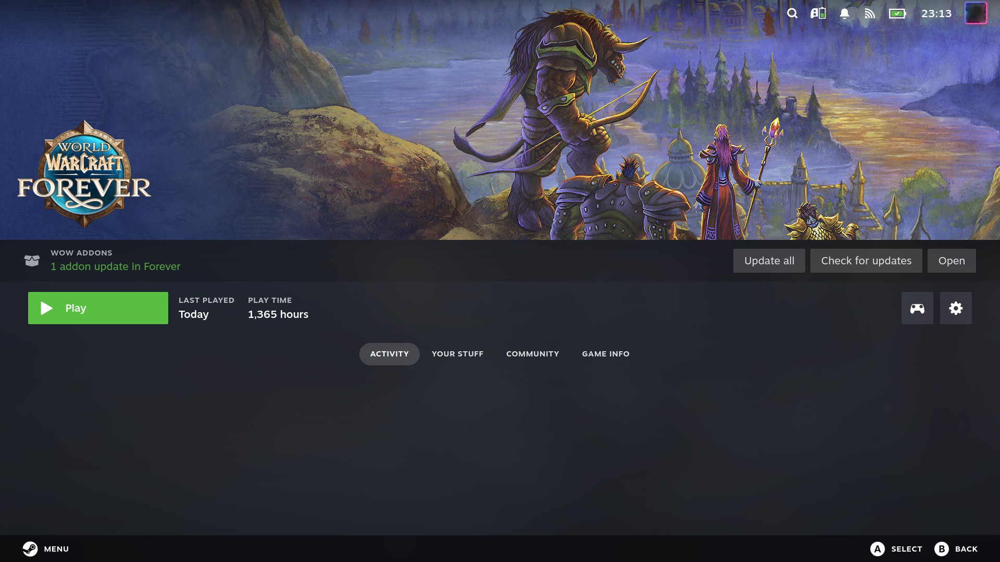

# WoWDeck Addon Manager

A [Decky Loader](https://github.com/SteamDeckHomebrew/decky-loader) plugin
that installs, updates and removes World of Warcraft addons on a Steam
Deck. No desktop, no add-on manager app: browse, search and manage your
addons from Game Mode.



The addon engine is a standalone binary supervised by the plugin's Python
backend — no Electron, no Node runtime on the device.

**Built with AI.** Most of this plugin's code was written by various LLM
agents.

## Install

You need a Steam Deck (SteamOS) with [Decky Loader](https://github.com/SteamDeckHomebrew/decky-loader)
installed and World of Warcraft installed on the device (any of the usual
places: Steam/Proton, Lutris, `~/Applications`, SD cards, or a custom path).

1. Open Decky (QAM · 🧩) → ⚙ Settings → **Developer Mode** → enable it.
2. **Install Plugin from URL**, and paste this link (paste it exactly —
   Decky matches the plugin by the file name at the end of the link):

   ```
   https://github.com/sigboe/wowdeck/releases/latest/download/WoWDeck.zip
   ```

3. Restart the Quick Access Menu if asked; the plugin appears as
   **WoWDeck** in Decky's plugin list (its panel title reads *WoWDeck
   Manager*).
4. First run: the plugin finds your WoW installation and flavor
   (retail/classic/era/…) — or asks you to point at it. A CurseForge API
   key is bundled, so search and installs work out of the box; you can
   set your own key in Options if you prefer.

## Updating

The plugin is not in the official Decky store, so updates come from
GitHub Releases. WoWDeck tells you itself: at most once a day — on plugin
load or when the Deck wakes — it checks and, when a newer release is out,
shows a toast and a row in Options → Updates with the link.

- **Built in:** press **Update** on that row. WoWDeck downloads and checks
  the release, then hands it to Decky's own installer, which asks you to
  confirm and reloads the plugin.
- **Alternatively:** install [Direct Updater](https://github.com/nukeador/deckyup)
  (also a Decky plugin). It detects WoWDeck, notices new releases and
  walks updates through Decky's own installer with a confirmation prompt.
- **Manually:** repeat the Install step with the same URL — Decky replaces
  the running version. (This is why the URL's file name must match the
  plugin name exactly.)

## What it does

- WoW detection (Lutris/`~/Applications`/`~/Games`, Steam Proton prefixes,
  SD cards, custom paths), flavor selection (retail/classic/era/...)
- Installed addon list incl. unmanaged folders; provider matching via TOC
  ids and WowUp fingerprints
- Find an online source for an unmanaged folder and manage it from then
  on (the hand-copied files are kept for Roll back)
- Search + install via CurseForge (bundled key by default, with a user-key
  fallback), WowUpHub, TukUI, GitHub Releases and WowInterface
- Install directly from a CurseForge/GitHub/WowInterface URL, or from a
  direct https link to a .zip, .rar or .7z file (RAR and 7z are unpacked by
  the system's 7-Zip or unrar, which SteamOS ships; such addons have no
  update source)
- Discover/Browse: popular and category-filtered CurseForge listings
- Update detection (release-id first, then version), update one/all with
  failure isolation (also every installation at once), remove, ignore
- Filter My Addons by name, folder, author or source; libraries (addons
  installed only as another's dependency) are tagged and can be hidden
- Roll back an update: the previous version is kept (Options shows the
  space used and can clear it)
- Optional automatic updates (off by default; never while WoW is running)
- Steam library: link your WoW entry (Options) and its game page shows
  waiting addon updates, with Update all, Check for updates and Open
- Release channels (Stable/Beta/Alpha) per addon for CurseForge and WowUp
  Hub
- Addon list import/export compatible with WowUp's export format
- Settings backup and restore of the WTF folder (keybinds, macros, UI
  layout) — see `docs/wtf-backup.md`
- Transactional installs (a failed install leaves the previous state
  intact), progress events, diagnostics with one-tap copy

## Troubleshooting

- **Logs** live at `~/homebrew/logs/wowdeck/` on the Deck (`engine.log`,
  `plugin.log`). The engine also accepts diagnostics copy from Options →
  Diagnostics.
- **No WoW installation found** — open Options → Installation and pick the
  folder containing `_retail_`/`_classic_` etc. directly.
- **CurseForge errors (403/429)** — the bundled key is shared by every
  install and can be rate-limited; set your own key in Options →
  CurseForge.
- **A plugin update didn't apply** — make sure the URL/file name used was
  exactly `WoWDeck.zip` (see Updating).
- Bugs and feature requests: [Issues](https://github.com/sigboe/wowdeck/issues),
  please include the logs and your SteamOS/Decky versions.

## Privacy

- The plugin contacts addon sources and nothing else: CurseForge
  (`api.curseforge.com`), WowUp Hub (`hub.wowup.io`), TukUI
  (`api.tukui.org`), GitHub (`api.github.com`), WowInterface/MMOUI
  (`api.mmoui.com`), plus the providers' download CDNs when you install.
- No telemetry, no crash reporting, no analytics. Searches, installs and
  the once-a-day plugin version check are the only outbound traffic.
- The bundled CurseForge key is treated as public (assume any bundled key
  is extracted eventually). Provide your own in Options if you want your
  own quota.

## Credits & legal

- **WoWDeck Addon Manager** is licensed under
  [GPL-3.0](LICENSE); third-party notices are in
  [`THIRD_PARTY_NOTICES.md`](THIRD_PARTY_NOTICES.md).
- Derived from [WowUp](https://github.com/WowUp/WowUp) (GPL-3.0),
  independently adapted for the Steam Deck; per-file provenance is
  recorded in [`docs/wowup-provenance.md`](docs/wowup-provenance.md).
- Not affiliated with or endorsed by Blizzard Entertainment, the WowUp
  project, or SteamDeckHomebrew/Deckbrew. "World of Warcraft" and
  Blizzard Entertainment are trademarks of Blizzard Entertainment, Inc.

## Development

Dependencies are listed in `flake.nix`. With Nix, `make` uses its dev
shell (`nix develop`); without Nix, install the same packages from your
distro and add `USE_NIX=0`:

```bash
make setup
make build test
```

Releases are tag-driven: `make version-set VERSION=X.Y.Z`, commit,
`make release-tag`, push the tag — see `docs/development.md`.

See `docs/development.md` and `AGENTS.md` for policy.

## Testing on a Steam Deck

```bash
make build package   # -> "build/WoWDeck.zip"
```

The zip is named after the plugin on purpose: Decky Loader recognises an
update by the file name, and any other name makes an update hang.

Install (any of):

- Decky UI → plugin browser → install from zip (developer mode), or
- `sudo unzip "build/WoWDeck.zip" -d /home/deck/homebrew/plugins`
  then restart Decky, or
- `python3 tools/package.py --keep-stage` also keeps the unzipped plugin
  folder, `build/wowdeck/`, to copy onto a test device file by file or
  into `~/homebrew/dev/plugins/wowdeck` for dev-mode iteration.

The engine binary is self-contained. Plugin data lives under the Decky
runtime dir (`state.json`); addon folders are only touched inside the
selected installation's `Interface/AddOns`.

## License

GPL-3.0 — see `LICENSE`. Third-party notices in `THIRD_PARTY_NOTICES.md`.
