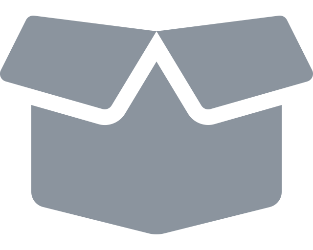
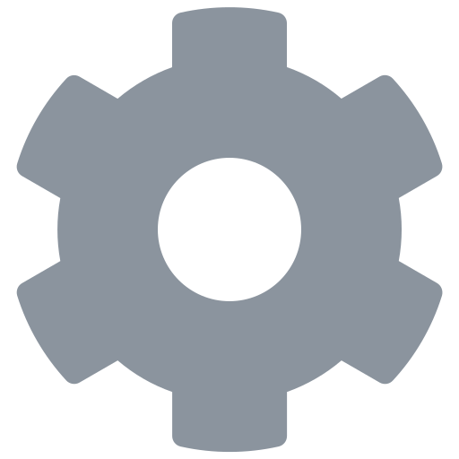
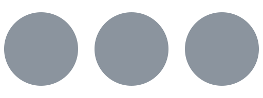
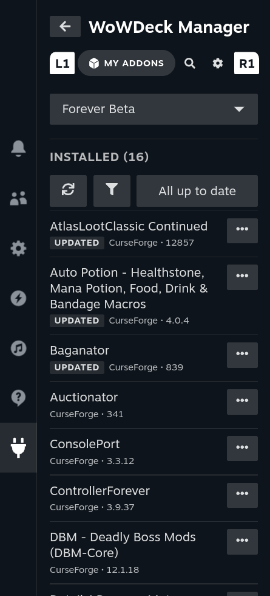

# WoWDeck Addon Manager

[](https://github.com/sigboe/wowdeck/actions/workflows/ci.yml) [](https://github.com/sigboe/wowdeck/actions/workflows/beta.yml) [](https://github.com/sigboe/wowdeck/releases/latest) [](LICENSE)

A [Decky Loader](https://github.com/SteamDeckHomebrew/decky-loader) plugin
to discover, install and update World of Warcraft addons on a Steam
Deck. You do it all from Game Mode, in the Quick Access Menu, without a
desktop addon manager or copying folders around.


**Built with AI.** LLM agents wrote most of this plugin's code.

## Install

You need a Steam Deck (SteamOS) with [Decky Loader](https://github.com/SteamDeckHomebrew/decky-loader)
installed, and World of Warcraft on the device. WoWDeck finds it under
Steam/Proton, Lutris or `~/Applications`, on an SD card, or at a custom
path.

1. Open the Quick Access Menu (the  button) → Decky →
    Settings → **General** and turn on **Developer mode**.
   Then switch to the **Developer** tab and, under **Third-Party
   Plugins**, pick one of these:

   - **Install Plugin from ZIP File** → **Browse**. First download
     [WoWDeck.zip](https://github.com/sigboe/wowdeck/releases/latest/download/WoWDeck.zip)
     from the [latest release](https://github.com/sigboe/wowdeck/releases/latest),
     either in Desktop Mode's browser or on any computer, and copy it
     over. Desktop Mode saves it to `~/Downloads`. **Browse** opens
     Decky's file picker in your home folder, showing only folders and
     zip files. Open `Downloads` and pick `WoWDeck.zip`.
   - **Install Plugin from URL**. Paste the short link:

     ```
     tinyurl.com/2bs8ts2h
     ```

     It is a TinyURL redirect to the long link below, and much easier to
     type on the Deck's keyboard:

     ```
     https://github.com/sigboe/wowdeck/releases/latest/download/WoWDeck.zip
     ```

     Decky adds `https://` itself if you leave it off.

2. Decky now shows its warning for third-party plugins, titled
   *Third-Party Plugin Installation* and printed in red on the Deck. It
   says:

   ```diff
   - The Decky Loader team has not reviewed this plugin. It may contain
   - malware, such as software to steal your Steam account or harm your
   - device. By installing this plugin, you agree you have assumed all
   - risks to your device.
   ```

   Every plugin installed outside the Decky store gets this warning, and
   **Continue** stays greyed out for five seconds while you read it. The
   zip comes from this repository's GitHub Releases.

3. First run: open Decky →  **WoWDeck**.
   It finds your WoW installation and flavor (retail, classic, era and so
   on) or asks you to point at it. Search and installs work without any
   setup, and you can set your own CurseForge key in Options if you
   prefer.

## Updating

The plugin is not in the official Decky store, so updates come from
GitHub Releases. WoWDeck checks about once a day, when the plugin loads
or the Deck wakes. When a newer release is out, you get one toast for
that version, an orange dot on the  Options tab, and a panel at
the top of Options with the **Update** button.

- **Update** downloads the release and verifies it, then hands it to
  Decky's own installer. Decky asks you to confirm and reloads the
  plugin.
- Press  on the Update button, or on the WoWDeck row under
  Options → Updates, to read what's new before you update.
- Press  on either of them to check again right away.
- The  button on the WoWDeck row picks the update channel.
  **Stable** is for most players. **Beta** is built from every merged
  change, so it gets new features first and may have bugs.
- **By hand.** Repeat the Install steps above. The same zip or link
  installs over the running version.

## What it does

<picture>
  <source media="(max-width: 767px)" srcset="docs/blank.png">
  <source srcset="docs/screenshot-panel.png 1.59x">
  
</picture>

- Finds WoW in Lutris, `~/Applications`, `~/Games`, Steam Proton
  prefixes, SD cards and custom paths, and lets you pick the flavor
  (retail, classic, era and so on).
- Lists installed addons, including folders you copied in by hand, and
  matches them to their source by TOC ids and WowUp fingerprints.
- Finds an online source for a hand-copied folder and manages it from
  then on. WoWDeck keeps the hand-copied files so you can roll back.
- Searches and installs from CurseForge, WowUp Hub, TukUI, GitHub
  Releases and WowInterface.
- Installs straight from a CurseForge, GitHub or WowInterface URL, or
  from an https link to a .zip, .rar or .7z file. The system's 7-Zip or
  unrar, which SteamOS ships, unpacks RAR and 7z files. Addons installed
  from such a link have no update source.
- Browses the Popular and Latest lists of CurseForge and WowUp Hub, and
  CurseForge's categories.
- Detects updates by release id first, then by version. Updates one
  addon or all of them, in every installation at once if you like. One
  failed update does not stop the rest.
- Removes addons, or ignores their updates.
- Filters My Addons by name, folder, author or source. It tags libraries
  (addons installed only because another addon needs them) and can hide
  them.
- Rolls back an update. WoWDeck keeps the previous version, and Options
  shows the space those copies use and can clear it.
- Updates addons automatically if you turn it on. It is off by default
  and never runs while WoW is running.
- Shows waiting addon updates on WoW's game page in the Steam library,
  with Update all, Check for updates and Open buttons. Link the game in
  Options first.
- Follows a release channel (Stable, Beta or Alpha) per addon on
  CurseForge and WowUp Hub.
- Imports and exports addon lists in WowUp's export format.
- Backs up and restores the WTF folder (keybinds, macros, UI layout), or
  copies those settings from one WoW version to another, such as Forever
  Beta into Forever. `docs/wtf-backup.md` has the details.
- Leaves the previous version in place when an install fails.
- Copies its diagnostics to the clipboard in one tap.

<picture>
  <source media="(max-width: 767px)" srcset="docs/screenshot-panel.png">
  
</picture>

## Troubleshooting

- **Logs** live at `~/homebrew/logs/wowdeck/` on the Deck (`engine.log`
  and `plugin.log`). Options → Diagnostics copies them in one tap.
- **No WoW installation found.** Open Options → Installation and pick
  the folder that holds `_retail_`, `_classic_` or another flavor
  folder.
- **CurseForge errors (403 or 429).** Set your own key under Options →
  CurseForge.
- **Options → Updates names a new version but shows no Update panel.**
  That release has no zip attached yet. Press  on the WoWDeck row
  to check again later, or update by hand as described above.
- **Anything else.** Open an [issue](https://github.com/sigboe/wowdeck/issues)
  and include the logs and your SteamOS and Decky versions.

## Privacy

- The plugin contacts addon sources and nothing else: CurseForge
  (`api.curseforge.com`), WowUp Hub (`hub.wowup.io`), TukUI
  (`api.tukui.org`), GitHub (`api.github.com`), WowInterface/MMOUI
  (`api.mmoui.com`), plus the providers' download servers when you
  install.
- No telemetry, crash reporting or analytics. The only outbound traffic
  is addon searches, installs and update checks. On top of that,
  WoWDeck checks for its own new version once a day and, when you update
  the plugin, downloads it from GitHub Releases.

## Credits & legal

- **WoWDeck Addon Manager** is licensed under [GPL-3.0](LICENSE).
  Third-party notices are in [`THIRD_PARTY_NOTICES.md`](THIRD_PARTY_NOTICES.md).
- Derived from [WowUp](https://github.com/WowUp/WowUp) (GPL-3.0) and
  adapted for the Steam Deck independently.
  [`docs/wowup-provenance.md`](docs/wowup-provenance.md) records where
  each file came from.
- Not affiliated with or endorsed by Blizzard Entertainment, the WowUp
  project, or SteamDeckHomebrew/Deckbrew. "World of Warcraft" and
  Blizzard Entertainment are trademarks of Blizzard Entertainment, Inc.

## Contributing

- Report bugs and ideas in [Issues](https://github.com/sigboe/wowdeck/issues),
  with the logs from `~/homebrew/logs/wowdeck/`. Troubleshooting says
  how to copy them.
- PRs target [`next`](https://github.com/sigboe/wowdeck/tree/next).
  `main` equals the newest published release and only receives `next` at
  release time, so a PR against `main` cannot merge.
- Branch off `next`, keep commits small and functional with imperative
  subjects, and expect a merge commit rather than a squash.
- A change players can see gets its line in `CHANGELOG.md` in the same
  commit. `docs/changelog.md` describes the format.
- CI runs lint, typecheck, tests and the build on every PR. Development
  below lists the commands.

## Development

WoWDeck has three parts: a TypeScript frontend in the Quick Access Menu,
a Python backend that Decky runs, and the addon engine, a standalone
binary that the Python backend starts and supervises.

`flake.nix` lists the dependencies. With Nix, `make` uses its dev shell
(`nix develop`). Without Nix, install the same packages from your distro
and add `USE_NIX=0`:

```bash
make setup
make lint typecheck test build
```

Merging `next` into `main` publishes a release, tag included.
`docs/development.md` describes the whole release flow, and `AGENTS.md`
holds the project policy.

## Testing on a Steam Deck

```bash
make build package   # -> "build/WoWDeck.zip"
```

The zip keeps the name `WoWDeck.zip` on purpose. The release workflow
attaches it under that name and WoWDeck's own updater looks for it, so
keep the name when repackaging.

Install it in any of these ways:

- Decky ( button) →  Settings → **Developer** →
  **Install Plugin from ZIP File**.
- `sudo unzip "build/WoWDeck.zip" -d /home/deck/homebrew/plugins`, then
  restart Decky.
- `python3 tools/package.py --keep-stage` also keeps the unzipped plugin
  folder, `build/wowdeck/`. Copy it onto a test device file by file, or
  into `~/homebrew/dev/plugins/wowdeck` to iterate in dev mode.

The engine binary is self-contained. Plugin data lives in
`~/homebrew/data/wowdeck/state.json`. WoWDeck changes addon folders only
inside the selected installation's `Interface/AddOns`.

## License

GPL-3.0. See `LICENSE` and `THIRD_PARTY_NOTICES.md`.
